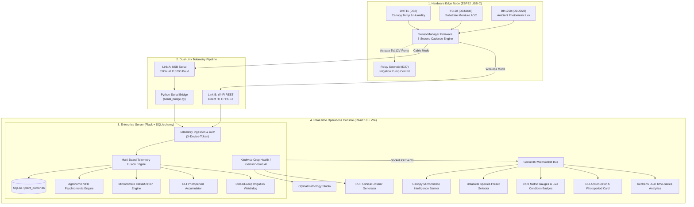
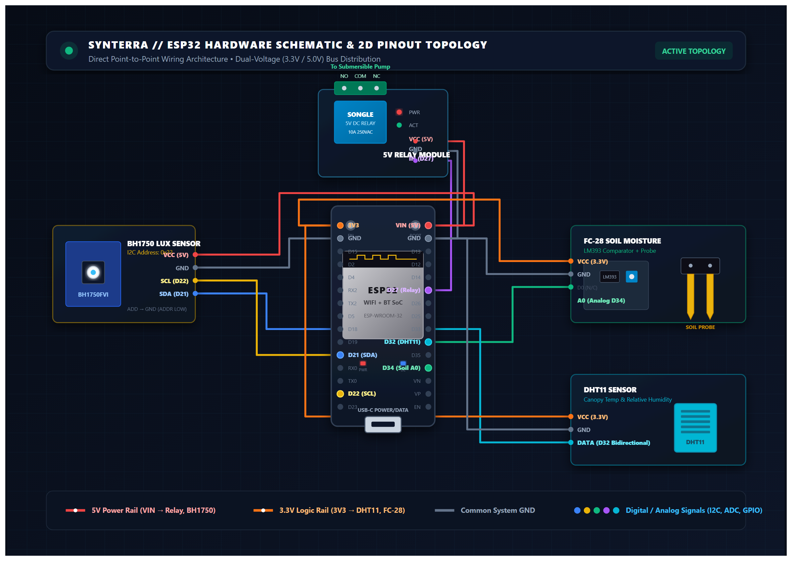
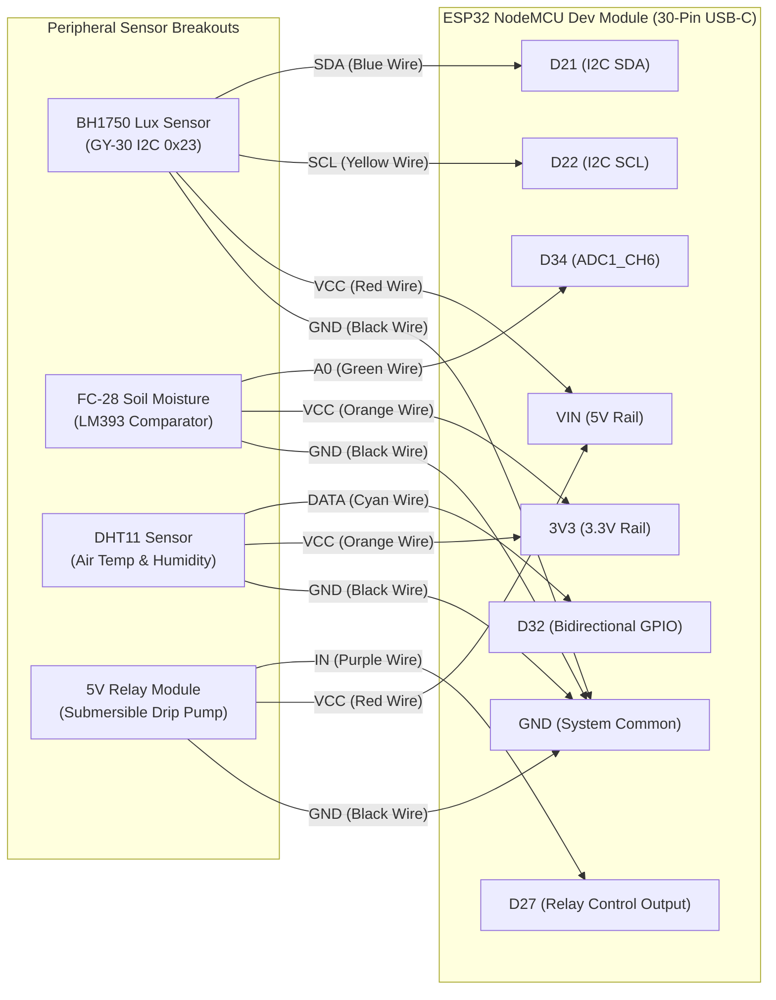
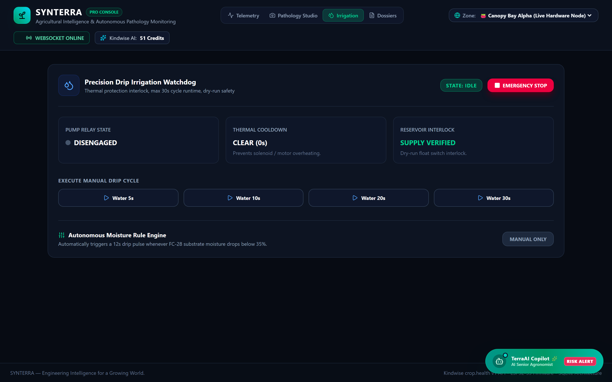
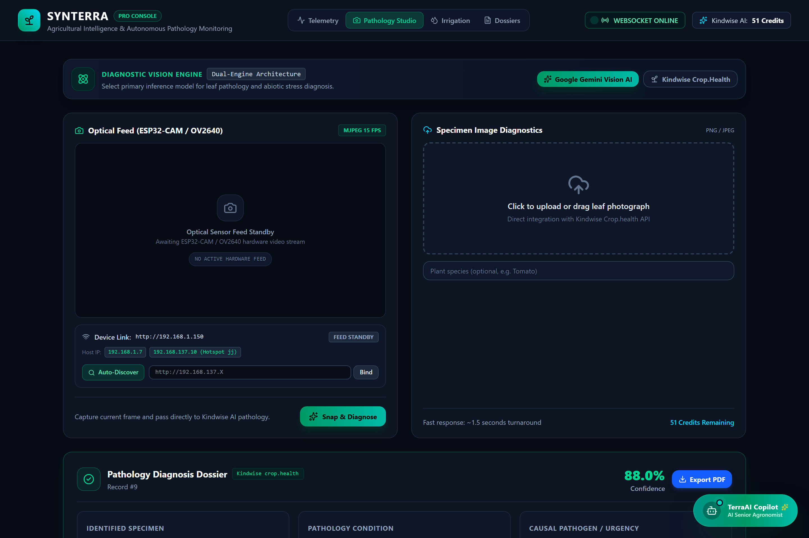
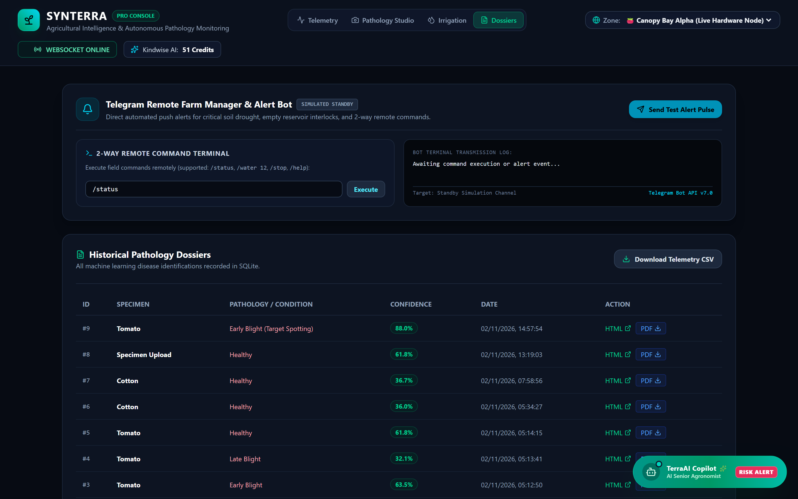
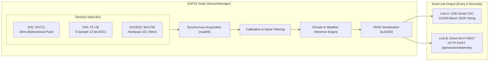
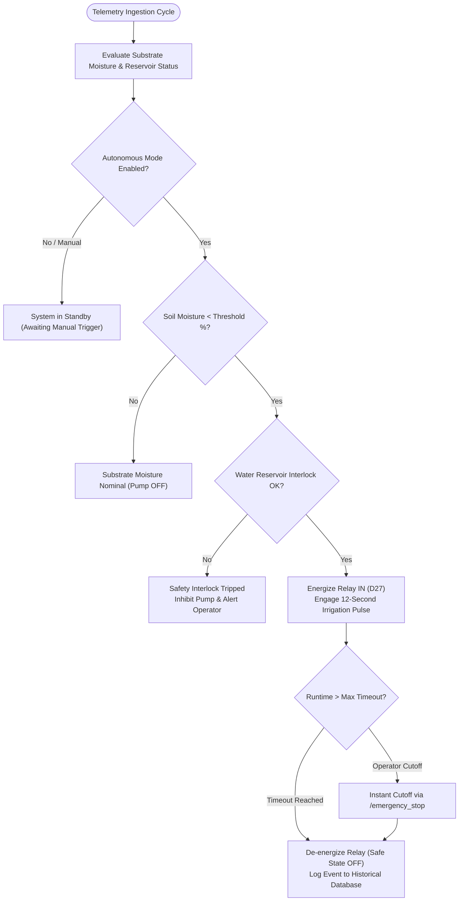
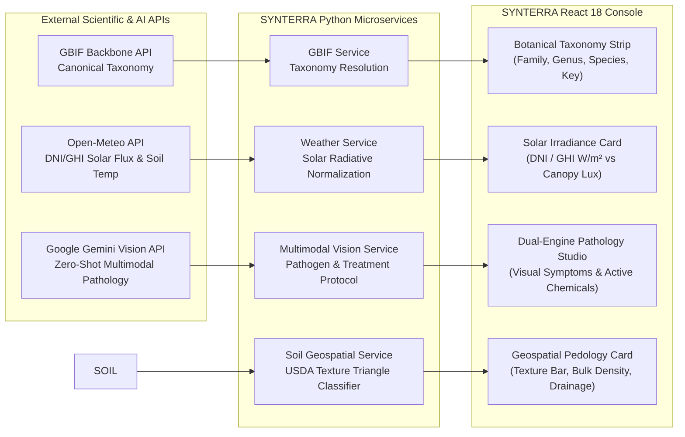

# 🌱 SYNTERRA
### Autonomous Botanical Intelligence & Precision AgriTech IoT Platform

**Engineering Precision Intelligence for Autonomous Agriculture.**

[](https://python.org)
[](https://espressif.com)
[](https://react.dev)
[](https://flask.palletsprojects.com)
[](https://tailwindcss.com)
[](LICENSE)

SYNTERRA is an enterprise-grade IoT and AI-driven precision agriculture platform. It bridges edge microcontroller sensing, closed-loop irrigation actuation, real-time agronomic telemetry fusion, and computer vision leaf pathology into an integrated laboratory console.

<p align="center">
  
</p>

---

## 📑 Table of Contents
1. [System Overview & Architecture](#-system-architecture)
2. [Bill of Materials (BOM) & Components](#-bill-of-materials-bom)
3. [Hardware Setup & Pinout Guide](#-hardware-setup--pinout-guide)
4. [Step-by-Step Firmware Flashing Guide](#-step-by-step-firmware-flashing-guide)
5. [Step-by-Step Backend & Server Setup](#-step-by-step-backend--server-setup)
6. [Telemetry Ingestion & Serial Bridge](#-telemetry-ingestion--serial-bridge)
7. [Core Technical Engines](#-core-technical-engines)
   - [Microclimate & Weather Classification Engine](#1-environmental-climate--condition-classification-engine)
   - [Multi-Crop Botanical Profiles](#2-multi-crop-botanical-profiles-smart-species-adaptation)
   - [Daily Light Integral (DLI) & Photoperiod Accumulator](#3-daily-light-integral-dli--photoperiod-accumulator)
   - [Closed-Loop Autonomous Irrigation & Safety Watchdog](#4-closed-loop-autonomous-irrigation-policy)
   - [Dual-Engine AI Leaf Pathology (Gemini Multimodal + Kindwise)](#5-dual-engine-ai-computer-vision-leaf-pathology)
   - [Authoritative GBIF Biodiversity Taxonomy Verification](#6-authoritative-biodiversity-taxonomy-verification-gbif)
   - [Solar Irradiance (DNI/GHI) & Microclimate Radiative Flux](#7-solar-irradiance-dnighi--microclimate-radiative-flux-open-meteo)
   - [FAO-56 Penman-Monteith Evapotranspiration ($ET_0$) & Soil Water Depletion](#8-fao-56-penman-monteith-evapotranspiration-et0--soil-water-depletion)
   - [Predictive Fungal Spore Incubation Risk (Smith Period & Mills Model)](#9-predictive-fungal-spore-incubation-risk-meter-smith-period--mills-model)
   - [Growing Degree Days (GDD) & BBCH Crop Phenology Tracker](#10-growing-degree-days-gdd--bbch-crop-phenology-stage-tracker)
   - [Multi-Zone / Multi-Node Greenhouse Fleet Management](#11-multi-zone--multi-node-greenhouse-fleet-management)
   - [Telegram Remote Farm Manager & Alert Bot with 2-Way Commands](#12-telegram-remote-farm-manager--alert-bot-with-2-way-commands)
8. [System Architecture Flowcharts](#-system-architecture-flowcharts)
9. [Complete REST API Reference](#-api-reference)
10. [Troubleshooting & FAQ](#-troubleshooting--faq)
11. [Project Directory Layout](#-project-directory-layout)

---

## 🏛️ System Architecture

SYNTERRA orchestrates four decoupled tiers: Edge Sensing & Actuation, Dual-Link Telemetry Ingestion, Ingestion & Multi-Board Telemetry Fusion, and the Real-Time React Operations Console.



---

## 📦 Bill of Materials (BOM)

To replicate this exact setup, source the following standard, low-cost components (~$25–$30 total):

| Component | Specification / Model | Operating Voltage | Interface / Protocol | Purpose in SYNTERRA |
| :--- | :--- | :--- | :--- | :--- |
| **Microcontroller** | ESP32 Dev Module (USB-C, 30 or 38 pins, ESP-WROOM-32) | 5V via USB-C (3.3V logic) | USB-UART, Wi-Fi 802.11 b/g/n, I2C, ADC | Edge sensor acquisition, telemetry streaming, relay switching. |
| **Ambient Light Sensor** | BH1750 (GY-30 Module) | 3.3V–5V (onboard 662K LDO) | Hardware I2C (`D21`=SDA, `D22`=SCL) | Measures photometric flux (1–65,535 Lux); powers DLI & photoperiod engine. |
| **Canopy Climate Sensor** | DHT11 (or DHT22 for higher precision) | 3.3V–5V | Single-Wire Digital Bus (`D32`) | Ambient air temperature (°C) & relative humidity (%). |
| **Soil Moisture Sensor** | FC-28 (or Capacitive v1.2) + LM393 Comparator | 3.3V | Analog Voltage Output (`D34` / ADC1) | Substrate rhizosphere moisture percentage and drought detection. |
| **Actuator Relay** | 1-Channel 5V Relay Module (Optocoupler-isolated) | 5V Coil Power (`VIN`) | Digital GPIO (`D27`, Active-HIGH) | Switches power to 5V–12V submersible irrigation pump or solenoid valve. |
| **Irrigation Pump** | 5V Mini Submersible DC Water Pump | 3.3V–5V DC | DC Terminals (via Relay NO/COM) | Dispenses water through silicon tubing during irrigation pulses. |
| **Prototyping Bus** | 400-Point or 830-Point Solderless Breadboard | N/A | Dupont Wires (M-M, M-F) | Mounts microcontroller and distributes power rails cleanly. |
| **Tubing & Reservoir** | 4mm/6mm Food-grade Silicon Tubing + Water Container | N/A | Fluidics | Delivers hydration directly to plant root zone. |

---

## 🔌 Hardware Setup & Pinout Guide

### 2D Circuit Wiring Schematic & Top-Down Architecture

<p align="center">
  
</p>



### Physical Breadboard & Wiring Arrangement

<p align="center">
  
</p>

### Exact Pin Connection Table
Connect each module pin to the exact silkscreen labels on your USB-C ESP32 board:

| Module / Sensor | Module Pin | ESP32 Board Pin | Wire Type | Power Rail | Electrical & Hardware Engineering Rationale |
| :--- | :--- | :--- | :--- | :--- | :--- |
| **DHT11** (Air Temp/RH) | `DATA / OUT` | **`D32`** | Signal | &mdash; | **Must be a Bidirectional GPIO.** DHT11 protocol requires the MCU to pull the line LOW for 18ms (Output), then listen for response pulses (Input). Input-only GPI pins (D34, D35, D36, D39) lack output drivers and will fail. |
| | `VCC (+)` | **`3V3`** | Power | 3.3V Rail | Safe 3.3V supply from ESP32 internal regulator. |
| | `GND (-)` | **`GND`** | Ground | Ground Rail | Common system ground. |
| **FC-28** (Soil Moisture) | `A0` (Analog) | **`D34`** | Signal | &mdash; | **Dedicated `ADC1_CH6` Channel.** ESP32 `ADC2` channels are shared with the Wi-Fi radio and crash/corrupt readings during Wi-Fi transmission. `ADC1` pins (like D34) remain rock-solid. |
| | `D0` (Digital) | **`D35`** | Signal | &mdash; | Optional digital comparator threshold alarm (Input-only pin). |
| | `VCC` | **`3V3`** | Power | 3.3V Rail | Low-noise regulated 3.3V supply. |
| | `GND` | **`GND`** | Ground | Ground Rail | Common system ground. |
| **BH1750** (Light Meter) | `SDA` | **`D21`** | I2C Data | &mdash; | Dedicated ESP32 Hardware I2C Serial Data line. |
| | `SCL` | **`D22`** | I2C Clock | &mdash; | Dedicated ESP32 Hardware I2C Serial Clock line. |
| | `VCC` | **`VIN` (5V)** | Power | 5V Rail | **Power from `VIN` (5V).** The blue GY-30 module features an onboard 662K 3.3V LDO regulator. When fed with 3.3V, sensor load causes input voltage to drop below the LDO dropout threshold (<2.9V), causing `[BH1750] Error: other error` (bus lockup). Feeding from `VIN` guarantees a clean 3.3V output. |
| | `GND` | **`GND`** | Ground | Ground Rail | Common system ground. |
| | `ADDR` | *Unconnected* | &mdash; | &mdash; | Internal pull-down resistor defaults to I2C address `0x23`. |
| **Relay Module** (Pump) | `IN / Signal` | **`D27`** | Signal | &mdash; | Digital Output pin. Held LOW on startup (normally OFF); energized HIGH during irrigation pulses. |
| | `VCC` | **`VIN` (5V)** | Power | 5V Rail | Powers the mechanical relay coil (requires 5V to energize). |
| | `GND` | **`GND`** | Ground | Ground Rail | Common system ground. |

---

## 💻 Step-by-Step Firmware Flashing Guide

Follow these steps to upload the firmware to your ESP32 board using **Arduino IDE**:

### 1. Install Arduino IDE & ESP32 Board Support
1. Download and install [Arduino IDE (v2.x or v1.8.x)](https://www.arduino.cc/en/software).
2. Open **File** &rarr; **Preferences**.
3. In **Additional Boards Manager URLs**, paste:
   ```text
   https://raw.githubusercontent.com/espressif/arduino-esp32/gh-pages/package_esp32_index.json
   ```
4. Open **Tools** &rarr; **Board** &rarr; **Boards Manager...**, search for `esp32` by **Espressif Systems**, and click **Install**.

### 2. Install Required Libraries
Open **Tools** &rarr; **Manage Libraries...** and install the following:
* **`DHT sensor library`** by *Adafruit* (accept prompt to install `Adafruit Unified Sensor`).
* **`BH1750`** by *Christopher Laws*.

### 3. Open and Configure Firmware
1. Open [`firmware/Sensor_Hardware_Diagnostic/Sensor_Hardware_Diagnostic.ino`](file:///D:/ml%20challenge/SYNTERRA/firmware/Sensor_Hardware_Diagnostic/Sensor_Hardware_Diagnostic.ino).
2. Configure your network credentials (lines 68–69):
   ```cpp
   const char* wifi_ssid     = "YOUR_WIFI_OR_HOTSPOT_NAME";
   const char* wifi_password = "YOUR_WIFI_PASSWORD";
   ```
   *(Note: 2.4 GHz Wi-Fi or Mobile Hotspot is required; ESP32 does not support 5 GHz Wi-Fi).*

### 4. Board Settings & Flashing
1. Connect the ESP32 to your PC using a USB-C data cable.
2. In Arduino IDE, configure under **Tools**:
   * **Board:** `ESP32 Dev Module`
   * **Upload Speed:** `115200` (or `921600` for faster uploads)
   * **CPU Frequency:** `240MHz (WiFi/BT)`
   * **Flash Frequency:** `80MHz`
   * **Flash Mode:** `QIO`
   * **Partition Scheme:** `Default 4MB with spiffs (1.2MB APP/1.5MB SPIFFS)`
   * **Port:** Select your Silicon Labs CP210x or CH340 COM Port (e.g. `COM6`).
3. Click the **Upload (➔)** button. *(If the IDE gets stuck at `Connecting......_____.....`, press and hold the physical **BOOT** button on the ESP32 board for 2 seconds until uploading begins).*

### 5. Verify in Serial Monitor
Open **Tools** &rarr; **Serial Monitor** and set the baud rate to **`115200`**. Every 6 seconds you should see:
```text
==========================================================
SYNTERRA — Autonomous Botanical Sensor Manager Node
==========================================================
[SENSOR MGR] Initializing DHT11 on D32...
[SENSOR MGR] Initializing Hardware I2C on SDA=D21, SCL=D22...
  ✓ [BH1750] Sensor online & calibrated!
[WIFI MGR] Connecting to 'jj'....
  ✓ [WIFI ONLINE] IP: 192.168.137.45 | Gateway: 192.168.137.1
==========================================================
SYSTEM READY — Polling and streaming sensors every 6s...
==========================================================

─── [TELEMETRY CYCLE #1 (EVERY 6s)] ────────────────────────────────
  🌤️  [CLIMATE STATE]   >>> CLOUDY / OVERCAST SKY <<<
  ✓ [BH1750]  Light:      480.0 Lux  --> [CLOUDY / OVERCAST]
  ✓ [DHT11]   Temp:        24.8 °C   --> [OPTIMAL PLANT TEMP]
              Humidity:    61.2 %    --> [IDEAL CANOPY HUMIDITY]
  ✓ [SOIL A0] Moisture:    56.4 % (ADC 2180) --> [OPTIMAL ROOT MOISTURE]
{"device_id":"esp32-sensor-01","plant_id":"test-specimen-1","temperature_c":24.8,"humidity_pct":61.2,"soil_moisture_pct":56.4,"soil_raw_adc":2180,"light_lux":480.0,"light_condition":"CLOUDY / OVERCAST","soil_condition":"OPTIMAL ROOT MOISTURE","temp_condition":"OPTIMAL PLANT TEMP","humidity_condition":"IDEAL CANOPY HUMIDITY","climate":"CLOUDY / OVERCAST SKY","water_reservoir_ok":true}
  ✓ [DASHBOARD SYNC] Posted to http://192.168.137.1:5000 (HTTP 201)
```

---

## 🚀 Step-by-Step Backend & Server Setup

### 1. Clone & Set Up Python Environment
```powershell
# 1. Clone repository
git clone https://github.com/sam-black007/SYNTERRA.git
cd SYNTERRA

# 2. Create virtual environment
python -m venv .venv

# 3. Activate virtual environment
# Windows PowerShell:
.\.venv\Scripts\Activate.ps1
# macOS / Linux Bash:
# source .venv/bin/activate

# 4. Install dependencies
pip install -r requirements.txt
```

### 2. Configure Environment Secrets
Create a `.env` file in the root folder (or copy `.env.example`):
```ini
FLASK_APP=run.py
FLASK_ENV=development
SECRET_KEY=synterra-precision-agritech-token-key-2026
DEVICE_TOKEN=plant-lab-auth-token-9981

# Plant.id / Kindwise API Key (Free tier from https://kindwise.com or https://plant.id)
PLANT_API_KEY=your_kindwise_api_key_here

# Local Server Gateway
SYNTERRA_API_URL=http://localhost:5000/api/sensors/telemetry
```

### 3. Launch the Platform
```powershell
# Double-click start.bat or execute:
python run.py
```
Open **`http://localhost:5000/dashboard`** in your browser.

---

## 📡 Telemetry Ingestion & Serial Bridge

SYNTERRA supports **three interchangeable telemetry transmission modes**:

### Mode 1: Direct Wi-Fi REST Mode (Wireless)
* The ESP32 connects directly to your Wi-Fi router or Mobile Hotspot.
* It sends an HTTP POST with JSON directly to `http://<laptop_gateway_ip>:5000/api/sensors/telemetry` every 6 seconds.
* **No cables required to the server PC.**

### Mode 2: USB Serial Cable Mode (`serial_bridge.py`)
* If Wi-Fi is unavailable (e.g. hackathon venue), plug the ESP32 into PC USB-C.
* Run the Python serial bridge script:
  ```powershell
  python scripts/serial_bridge.py
  ```
* The script auto-detects the connected COM port, parses incoming JSON lines, and forwards them to the Flask REST endpoint.

### Mode 3: Benchmark Simulation Mode (Zero Hardware)
* If hardware is not yet built, test the full dashboard using realistic synthetic telemetry:
  ```powershell
  python scripts/serial_bridge.py --mock
  ```

---

## 🧠 Core Technical Engines

### 1. Environmental Climate & Condition Classification Engine

The firmware and backend evaluate ambient photometric, thermal, psychrometric, and substrate metrics to classify states in real time:

#### A. Photometric Flux Classifications (BH1750 Lux)
* **`< 25 Lux`** &rarr; `🌙 Night / Dark` *(Transpiration paused; dark respiration active)*
* **`25 – 200 Lux`** &rarr; `🌆 Dim / Twilight` *(Low indoor light or twilight transition)*
* **`200 – 1,000 Lux`** &rarr; `☁️ Cloudy / Overcast` *(Soft diffused sunlight under cloud cover)*
* **`1,000 – 10,000 Lux`** &rarr; `⛅ Daylight / Partly Cloudy` *(Optimal daylight photosynthetic radiation)*
* **`10,000 – 25,000 Lux`** &rarr; `☀️ Sunny / Clear Sky` *(Peak clear sky solar radiation)*
* **`> 25,000 Lux`** &rarr; `🔥 Intense Direct Sunlight` *(Elevated radiation; rapid evapotranspiration)*

#### B. Substrate Moisture Classifications (FC-28 Soil Moisture)
* **`< 20 %`** &rarr; `🏜️ Critical Drought` *(Immediate autonomous irrigation triggered)*
* **`20 – 40 %`** &rarr; `⚠️ Dry (Needs Water)` *(Substrate depleted; watering cycle required)*
* **`40 – 75 %`** &rarr; `🌱 Optimal Root Moisture` *(Ideal rhizosphere oxygen & moisture balance)*
* **`> 75 %`** &rarr; `💧 Wet / Saturated` *(Roots fully hydrated)*

#### C. Thermal & Psychrometric Classifications (DHT11)
* **Temperature:** `< 16°C` Cold | `16–22°C` Mild/Cool | `22–28°C` Optimal | `28–34°C` Warm | `> 34°C` Heatwave
* **Relative Humidity:** `< 35%` Arid | `35–65%` Ideal Humidity | `65–80%` Humid/Tropical | `> 80%` Saturated Air
* **Vapor Pressure Deficit (VPD):** Calculated via psychrometric saturation curves:
  $$\text{VP}_{\text{sat}} = 0.61078 \times e^{\left(\frac{17.27 \times T}{T + 237.3}\right)}, \quad \text{VPD} = \text{VP}_{\text{sat}} \times \left(1 - \frac{\text{RH}}{100}\right)$$

---

### 2. Multi-Crop Botanical Profiles (Smart Species Adaptation)

SYNTERRA automatically reconfigures autonomous watering thresholds, target VPD limits, and photoperiod goals based on the active crop:

| Species Preset | Scientific Name | Category | Temp Target | Moisture Target | Auto-Watering Trigger | Target DLI | Optimal VPD |
| :--- | :--- | :--- | :--- | :--- | :--- | :--- | :--- |
| **🍅 Tomato** | *Solanum lycopersicum* | Fruiting Solanaceae | $20–26^\circ\text{C}$ | $50–70\%$ | **$45\%$** | $16.0\text{ mol/m}^2/\text{d}$ | $0.8–1.2\text{ kPa}$ |
| **🌿 Sweet Basil** | *Ocimum basilicum* | Culinary Herb | $20–25^\circ\text{C}$ | $60–80\%$ | **$55\%$** | $12.0\text{ mol/m}^2/\text{d}$ | $0.7–1.1\text{ kPa}$ |
| **🍓 Strawberry** | *Fragaria × ananassa* | Berry Crop | $18–24^\circ\text{C}$ | $55–70\%$ | **$50\%$** | $14.0\text{ mol/m}^2/\text{d}$ | $0.6–1.0\text{ kPa}$ |
| **🥬 Lettuce** | *Lactuca sativa* | Leafy Green | $15–21^\circ\text{C}$ | $65–85\%$ | **$60\%$** | $10.0\text{ mol/m}^2/\text{d}$ | $0.5–0.9\text{ kPa}$ |
| **🌵 Succulent** | *Aloe barbadensis* | Xerophytic Succulent | $21–32^\circ\text{C}$ | $15–35\%$ | **$18\%$** | $18.0\text{ mol/m}^2/\text{d}$ | $1.2–1.6\text{ kPa}$ |
| **🪴 Monstera** | *Monstera deliciosa* | Tropical Aroid | $20–28^\circ\text{C}$ | $40–60\%$ | **$35\%$** | $8.0\text{ mol/m}^2/\text{d}$ | $0.6–1.0\text{ kPa}$ |

---

### 3. Daily Light Integral (DLI) & Photoperiod Accumulator

Rather than evaluating instantaneous Lux in isolation, SYNTERRA tracks **Daily Light Integral (DLI)**—the cumulative photosynthetic photon flux delivered over a 24-hour cycle:

$$\text{PPFD} \approx \frac{\text{Lux}}{54} \quad (\mu\text{mol} \cdot \text{m}^{-2} \cdot \text{s}^{-1})$$

$$\text{DLI} = \sum_{i} \left( \text{PPFD}_i \times \Delta t_i \right) \times 10^{-6} \quad (\text{mol} \cdot \text{m}^{-2} \cdot \text{d}^{-1})$$

* **Photoperiod Tracker:** Continuously integrates active daylight duration ($\text{Lux} \ge 200$) vs. species target photoperiod.
* **Photometric Gauge:** Displays real-time progress toward the crop's daily photon quota ($16\text{ mol/m}^2/\text{d}$ for Tomato).

---

### 4. Closed-Loop Autonomous Irrigation Policy

<p align="center">
  
</p>

1. Telemetry packet arrives every 6s.
2. If `auto_mode_enabled` is active, compares current `soil_moisture_pct` against `irrigation_manager.soil_threshold_pct`.
3. If moisture is below threshold, checks `water_reservoir_ok`.
4. If reservoir is safe, energizes relay pin `D27` for 12 seconds.
5. If reservoir runs dry, a hardware interlock halts pump execution to prevent dry-run motor burnout.
6. A software emergency shutoff (`POST /api/irrigation/emergency_stop`) can cut power in <100ms.

---

### 5. Dual-Engine AI Computer Vision Leaf Pathology

<p align="center">
  
</p>

SYNTERRA features an enterprise dual-inference architecture allowing users to dynamically select between deep botanical models and state-of-the-art multimodal vision foundation models:

* **Engine A: Google Gemini Multimodal Vision API (`gemini-3.8-flash` / `gemini-flash-latest`):**
  * Parses high-resolution macroscopic foliage imagery directly with domain prompts for biological pathogens (*Alternaria*, *Septoria*, *Phytophthora*) and abiotic nutritional deficiencies (*Iron Chlorosis*, *Blossom End Rot / Calcium Deficit*).
  * Returns structured JSON: primary diagnosis, confidence percentage, list of key visual symptoms, differential diagnoses, active biochemical ingredients (*Copper Octanoate*, *Bacillus subtilis*, *Mancozeb*), and step-by-step clinical remediation protocols.
  * Resilient fallback cascade to local agronomic rule engine if external rate limits occur.
* **Engine B: Kindwise Crop.Health API:**
  * Specialized botanical neural network trained on millions of agricultural specimens, delivering rapid classification of infectious foliar lesions.
* **Clinical PDF Dossier Generator:** Exports printable diagnostic dossiers (`/api/diagnosis/<id>/pdf`) detailing chemical MOAs (Modes of Action), safety intervals, and integrated pest management (IPM) practices.


---

### 6. Authoritative Biodiversity Taxonomy Verification (GBIF)

To prevent misidentification and ensure botanical rigour, SYNTERRA cross-verifies all monitored crops against the **Global Biodiversity Information Facility (GBIF) Backbone Taxonomy**:

* **GBIF Species Match API Integration (`https://api.gbif.org/v1/species/match`):** Resolves canonical botanical binomials (*Solanum lycopersicum L.*, *Ocimum basilicum L.*) in real time.
* **Full Phylogenetic Tree:** Ingests and renders complete taxonomic hierarchies:
  $$	ext{Kingdom} 	o 	ext{Phylum} 	o 	ext{Class} 	o 	ext{Order} 	o 	ext{Family} 	o 	ext{Genus} 	o 	ext{Species}$$
* **Authoritative Attribution:** Displays official GBIF Usage Keys, verification status (`ACCEPTED`), and match confidence scores directly in the Botanical Target banner.

---

### 7. Solar Irradiance (DNI/GHI) & Microclimate Radiative Flux (Open-Meteo)

SYNTERRA correlates ambient photometric Lux measured by the on-site BH1750 with global shortwave radiative models via **Open-Meteo Solar Radiation Reanalysis**:

* **Direct Normal Irradiance (DNI in $W/m^2$):** Measures direct beam solar flux perpendicular to the sun's rays.
* **Global Horizontal Irradiance (GHI in $W/m^2$):** Quantifies total hemispherical solar radiation incident on a horizontal surface.
* **Outdoor Topsoil Temperature ($^\circ C$):** Substrate temperature at 0–7 cm depth from atmospheric boundary models.
* **Hardware Cross-Validation:** Compares outdoor solar flux against canopy Lux, providing actionable intelligence on greenhouse shading transmission efficiency and cloud cover attenuation.

---

### 8. FAO-56 Penman-Monteith Evapotranspiration ($ET_0$) & Soil Water Depletion

SYNTERRA implements the internationally standardized **FAO-56 Penman-Monteith equation** (Food and Agriculture Organization Irrigation and Drainage Paper No. 56) to model reference evapotranspiration ($ET_0$) and predict soil moisture depletion rates:

$$ET_0 = \frac{0.408 \Delta (R_n - G) + \gamma \frac{900}{T + 273} u_2 (e_s - e_a)}{\Delta + \gamma (1 + 0.34 u_2)}$$

Where:
* $R_n$: Net radiation at the crop surface ($MJ \cdot m^{-2} \cdot \text{day}^{-1}$), dynamically converted from Open-Meteo GHI and canopy lux.
* $G$: Soil heat flux density ($MJ \cdot m^{-2} \cdot \text{day}^{-1}$), modeled from diurnal ambient temperature amplitudes.
* $T$: Mean canopy air temperature ($^\circ C$) ingested from the physical DHT11 sensor.
* $u_2$: Wind speed at 2 m height ($m/s$), standardized for greenhouse microclimates with active circulation.
* $e_s - e_a$: Vapor pressure deficit ($kPa$), computed from psychrometric saturation curves.
* $\Delta$: Slope of the saturation vapor pressure curve ($kPa / ^\circ C$).
* $\gamma$: Psychrometric constant ($\approx 0.0673\text{ kPa}/^\circ C$ at sea level).

#### Crop Evapotranspiration & Depletion Hours Forecaster:
$$ET_c = K_c \times ET_0$$

* **Crop Coefficient ($K_c$):** Dynamically referenced from active crop profile (e.g. $K_c = 1.15$ for fruiting Tomato; $K_c = 0.95$ for Sweet Basil).
* **Volumetric Water Consumption:** Converts $mm/\text{day}$ into daily container water loss:
  $$\text{Daily Container Consumption } (mL/\text{pot/day}) = ET_c \times \text{Container Surface Area} \times 10$$
* **Depletion Forecaster:** Projects hours remaining until substrate moisture drops to the active irrigation threshold based on current soil water storage and transpiration rate.

---

### 9. Predictive Fungal Spore Incubation Risk Meter (Smith Period & Mills Model)

Rather than waiting for visible disease lesions to appear, SYNTERRA computes real-time infection risk scores for airborne pathogens (*Alternaria solani* early blight, *Phytophthora infestans* late blight, *Botrytis cinerea* gray mold) using the **Smith Period criteria** and **Mills Infection Period models**:

* **Smith Period Criteria:** A period of at least two consecutive days where:
  1. Minimum temperature $T_{\min} \ge 10^\circ C$
  2. Relative humidity $RH \ge 75\%$ for at least 11 hours per day
* **Spore Germination Index ($0 - 100\%$):** Evaluates leaf wetness duration, relative humidity dwell time, and thermal favorability curve:
  $$\text{Risk Index} = f(RH_{\text{dwell}}, T_{\text{mean}}, \text{VPD}_{\text{depression}})$$
* **Preventative Advisory Engine:**
  * **$0 - 35\%$ (Negligible Risk):** Dry foliar microclimate. Spore germination suspended.
  * **$35 - 70\%$ (Moderate Watch):** Borderline humidity. Pathogen sporulation possible; increase ventilation fan speed.
  * **$70 - 100\%$ (High / Critical Alert):** Prolonged leaf moisture and elevated thermal conditions. Immediate bio-fungicide preventative spray (*Bacillus subtilis* or copper octanoate) advised before mycelial penetration.

---

### 10. Growing Degree Days (GDD) & BBCH Crop Phenology Stage Tracker

SYNTERRA tracks the developmental aging of crops by accumulating thermal heat units (**Growing Degree Days - GDD**), eliminating guesswork based on calendar days:

$$GDD = \sum \max\left( \frac{T_{\max} + T_{\min}}{2} - T_{\text{base}}, 0 \right)$$

* **Base Temperature ($T_{\text{base}}$):** Species-calibrated threshold below which growth arrests ($10^\circ C$ for Tomato, $12^\circ C$ for Sweet Basil).
* **BBCH Phenological Scale Mapping:**
  * **BBCH 00–09:** *Germination & Seedling Emergence* ($0 - 120\text{ GDD}$)
  * **BBCH 10–19:** *Vegetative Leaf Development* ($120 - 320\text{ GDD}$)
  * **BBCH 51–65:** *Inflorescence & Flowering* ($320 - 550\text{ GDD}$)
  * **BBCH 71–79:** *Fruit Development & Setting* ($550 - 850\text{ GDD}$)
  * **BBCH 81–89:** *Fruit Ripening & Harvest Maturity* ($> 850\text{ GDD}$)
* **Real-Time Progress Bar:** Displays percentage completion within the current growth stage and exact heat units remaining until the next phenological phase.

---

### 11. Multi-Zone / Multi-Node Greenhouse Fleet Management

For commercial and research multi-bay facilities, SYNTERRA supports multi-node greenhouse fleet management:

* **Top Header Zone Selector:** Seamlessly switch between monitored greenhouse zones from any view without reloading.
* **Default Active Fleet Profiles:**
  * **Zone 1: Canopy Bay Alpha:** Connected to physical ESP32 USB-C hardware node monitoring a fruiting Beefsteak Tomato crop (*Solanum lycopersicum*).
  * **Zone 2: Propagation Nursery Beta:** Monitoring Sweet Basil seedling propagation (*Ocimum basilicum*) under controlled microclimate.
  * **Zone 3: Hydroponic NFT Gutter Gamma:** Monitoring nutrient film technique Butterhead Lettuce (*Lactuca sativa*).
* **Dynamic Recalibration:** Switching zones instantly reconfigures botanical targets, safe VPD thresholds, irrigation trigger setpoints, and FAO-56 $K_c$ crop coefficients.

---

### 12. Telegram Remote Farm Manager & Alert Bot with 2-Way Commands

<p align="center">
  
</p>

SYNTERRA features direct bidirectional integration with the **Telegram Bot API v7.0**, enabling agronomists and operators to monitor and control their facility from any mobile device:

* **Automated Instant Push Notifications:**
  * **🚨 Critical Soil Drought:** Dispatched immediately when soil moisture drops below critical limits ($< 20\%$).
  * **⚠️ Reservoir Safety Trip:** Dispatched when the hardware float switch detects a depleted water supply and disengages the pump.
  * **🔬 AI Disease Identification:** Dispatched when Gemini Multimodal AI or Kindwise classifies a high-confidence foliar pathogen.
* **2-Way Remote Field Commands:**
  * `/status` &rarr; Returns live canopy temperature, relative humidity, substrate moisture %, photometric flux lux, and active irrigation mode.
  * `/water <seconds>` &rarr; Remotely commands an emergency irrigation pulse (5s–30s) on relay GPIO D27.
  * `/stop` &rarr; Emergency shutoff command; cuts solenoid power in <100ms.
  * `/help` &rarr; Prints the complete command manual with parameter specifications.
* **Embedded Test & Simulation Console:** In the Dossiers tab, operators can dispatch test alert pulses and execute 2-way bot terminal commands with immediate transmission feedback.

---

## 📊 System Architecture Flowcharts

### 1. Edge Microcontroller Signal & Firmware Flow


### 2. Closed-Loop Autonomous Irrigation Flowchart


### 3. AI Leaf Pathology Pipeline


#### Flowchart 5: Multi-Source Geospatial & Multimodal AI Ingestion Pipeline



---

## 📡 API Reference

| Endpoint | Method | Headers / Auth | Description |
| :--- | :--- | :--- | :--- |
| `/dashboard` | `GET` | &mdash; | **Real-Time React 18 Operations Console** |
| `/api/sensors/telemetry` | `POST` | `X-Device-Token` | Ingest sensor telemetry JSON |
| `/api/sensors/latest` | `GET` | &mdash; | Retrieve latest fused sensor readings with condition badges |
| `/api/sensors/dli` | `GET` | &mdash; | **Calculate cumulative Daily Light Integral (DLI) & photoperiod** |
| `/api/crops/profiles` | `GET` | &mdash; | List botanical species presets with custom targets |
| `/api/crops/active` | `GET/POST`| &mdash; | Get or switch active crop preset (auto-calibrates irrigation) |
| `/api/sensors/history` | `GET` | &mdash; | Historical telemetry records (`?limit=50`) |
| `/api/sensors/export/csv`| `GET` | &mdash; | Export complete sensor history as CSV |
| `/api/diagnose` | `POST` | &mdash; | Upload leaf photo &rarr; Kindwise Crop.Health disease detection |
| `/api/diagnose/multimodal`| `POST`| &mdash; | **Google Gemini Multimodal AI leaf pathology & active ingredients** |
| `/api/biodiversity/species`| `GET` | &mdash; | **Query GBIF for authoritative botanical taxonomic hierarchy** |
| `/api/weather/solar` | `GET` | &mdash; | **Query Open-Meteo for Direct Normal & Global Solar Irradiance** |
| `/api/diagnoses` | `GET` | &mdash; | List all historical pathology diagnoses |
| `/api/diagnosis/<id>/pdf`| `GET` | &mdash; | **Download Official PDF Pathology Dossier with Treatment Plan** |
| `/api/irrigation/status` | `GET` | &mdash; | Read solenoid pump state, countdown & safety interlocks |
| `/api/irrigation/manual` | `POST` | &mdash; | Execute timed manual irrigation pulse (5s–30s) |
| `/api/irrigation/emergency_stop` | `POST` | &mdash; | Instant solenoid pump emergency shutoff |
| `/api/camera/stream` | `GET` | &mdash; | Real-time optical MJPEG video stream |
| `/api/camera/capture` | `POST` | &mdash; | Capture frame from camera node & run AI diagnosis |
| `/api/agronomy/analytics` | `GET` | &mdash; | **FAO-56 $ET_0$, water depletion forecast, Smith Period spore risk & GDD** |
| `/api/fleet/zones` | `GET` | &mdash; | **List multi-zone greenhouse registry with active node & telemetry** |
| `/api/fleet/select` | `POST` | &mdash; | **Switch active greenhouse bay and auto-apply crop profile** |
| `/api/telegram/status` | `GET` | &mdash; | **Telegram bot connection status, configured mode & chat ID** |
| `/api/telegram/test` | `POST` | &mdash; | **Dispatch immediate test alert pulse to Telegram** |
| `/api/telegram/command` | `POST` | &mdash; | **Execute 2-way remote command (`/status`, `/water <sec>`, `/stop`)** |

---

## 🛠️ Troubleshooting & FAQ

#### 1. Why does Serial Monitor print `[BH1750] Error: other error` (I2C Return Code 4)?
* **Cause:** The BH1750 light sensor module is powered from 3.3V while other sensors draw power, causing voltage to dip below the onboard 662K LDO regulator's minimum dropout threshold (<2.9V).
* **Fix:** Move the BH1750 `VCC` wire from `3V3` to the **`VIN` (5V)** pin.

#### 2. Why does the DHT11 sensor read `nan` or zero?
* **Cause:** The data wire is plugged into an input-only pin (`D34`, `D35`, `D36`, `D39`).
* **Fix:** Ensure the DHT11 data pin is connected to **`D32`**, which is a true bidirectional GPIO.

#### 3. Why does Soil Moisture read `0%` or stay stuck at `4095`?
* **Cause:** The sensor probes are not in moist soil, or calibration bounds need tuning for your soil type.
* **Fix:** Dry air produces raw ADC `~3400–4095`. Water produces raw ADC `~1200–1400`. Verify probes are clean and submerged in substrate.

#### 4. The ESP32 fails to connect to Wi-Fi.
* **Cause:** The router or phone hotspot is set to 5 GHz.
* **Fix:** Switch your mobile hotspot to **2.4 GHz Band** (on Android/iOS: *"Maximize Compatibility"*).

#### 5. The browser dashboard shows old numbers.
* **Fix:** Press **`Ctrl + Shift + R`** to perform a hard reload and bust the browser Vite bundle cache.

---

## 📂 Project Directory Layout

```text
SYNTERRA/
├── app/
│   ├── models/
│   │   ├── diagnosis.py            # SQLite ORM for Plant Pathology records
│   │   └── sensor.py               # SQLite ORM for Telemetry & Climate Condition properties
│   ├── routes/
│   │   ├── api.py                  # Telemetry ingestion, DLI, Crops, Irrigation & Camera APIs
│   │   ├── main.py                 # HTML dashboard routing
│   │   └── pathology.py            # Kindwise diagnosis image routes
│   └── services/
│       ├── agronomic_analytics_service.py # FAO-56 ET0, Spore Risk & GDD Phenology model
│       ├── camera_service.py       # MJPEG optical streaming & clean standby frame
│       ├── crop_profiles.py        # Centralized botanical species configuration
│       ├── fleet_service.py        # Multi-zone greenhouse bay registry
│       ├── irrigation_controller.py# Closed-loop watchdog, safety timeouts & emergency cutoff
│       ├── pdf_generator.py        # ReportLab PDF clinical dossier compiler
│       ├── plantid_client.py       # Kindwise Crop.Health / Plant.id API client
│       └── telegram_bot_service.py # Telegram push alerts & 2-way command handler
├── docs/
│   └── images/
│       ├── dashboard_live.png          # High-resolution real-time console preview
│       ├── dashboard_full_overview.png # Comprehensive full-page overview console
│       ├── pathology_studio_live.png   # Dual-Engine AI Pathology Studio preview
│       ├── irrigation_watchdog_live.png# Autonomous Irrigation Watchdog preview
│       ├── telegram_bot_console_live.png# Telegram Remote Farm Manager console preview
│       ├── hardware_schematic_2d.png   # 2D circuit wiring schematic graphic
│       ├── hardware_schematic_2d.svg   # Scalable vector graphics schematic source
│       └── esp32_hardware_setup.jpg    # Physical ESP32 bench arrangement photo
├── firmware/
│   └── Sensor_Hardware_Diagnostic/
│       └── Sensor_Hardware_Diagnostic.ino # Production SensorManager ESP32 firmware (6s cadence)
├── frontend/
│   ├── src/
│   │   ├── App.jsx                 # Full React 18 Laboratory Console
│   │   └── components/
│   │       └── ChatbotWidget.jsx   # AI Botanist floating assistant widget
│   └── dist/                       # Production-compiled assets served by Flask
├── scripts/
│   └── serial_bridge.py            # USB serial-to-REST telemetry forwarding bridge
├── instance/
│   └── plant_doctor.db             # Local SQLite database
├── run.py                          # Application entry point
├── requirements.txt                # Python backend dependencies
└── README.md                       # Comprehensive system documentation
```

---

## 📄 License & Attribution

Designed and engineered for precision autonomous agriculture. All rights reserved. Distributed under the MIT License.
