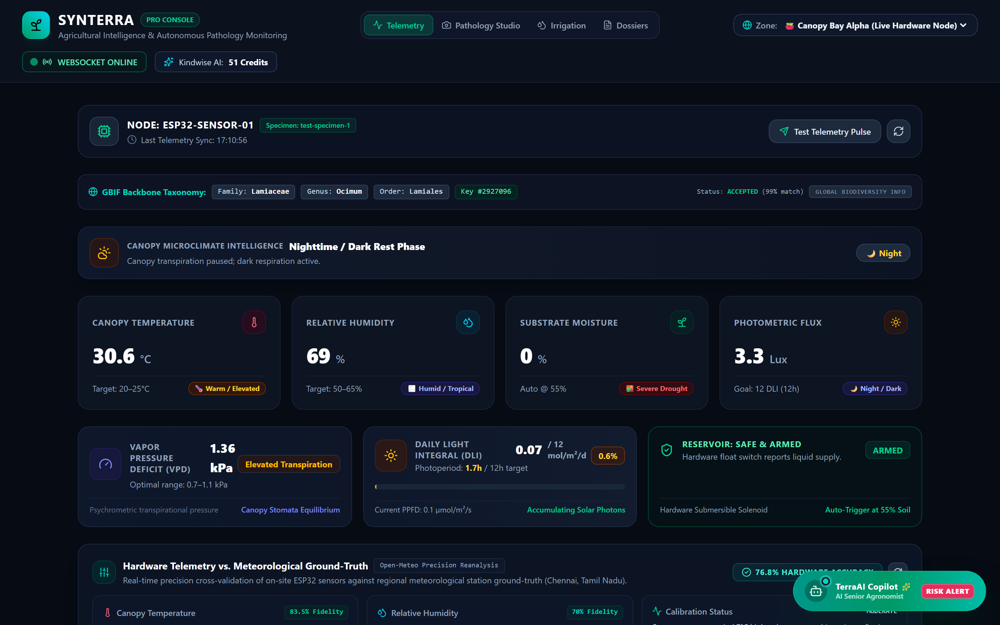
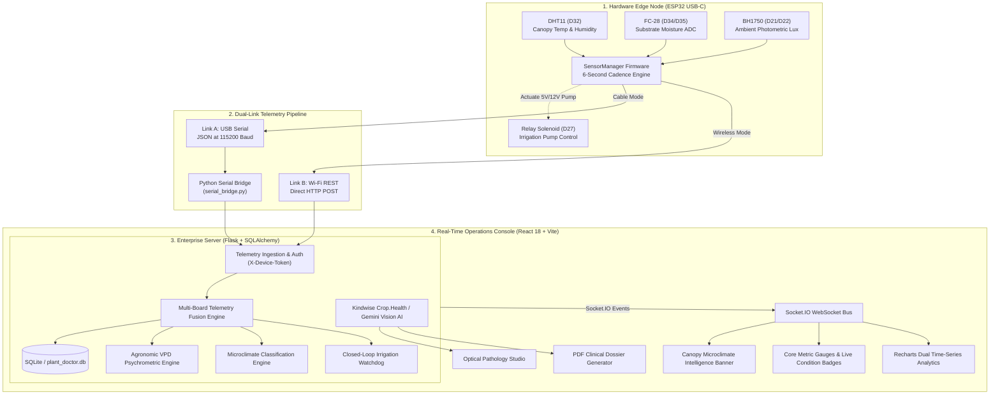
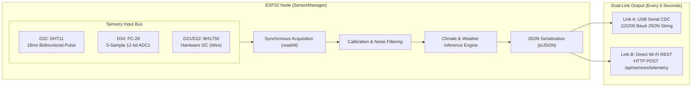
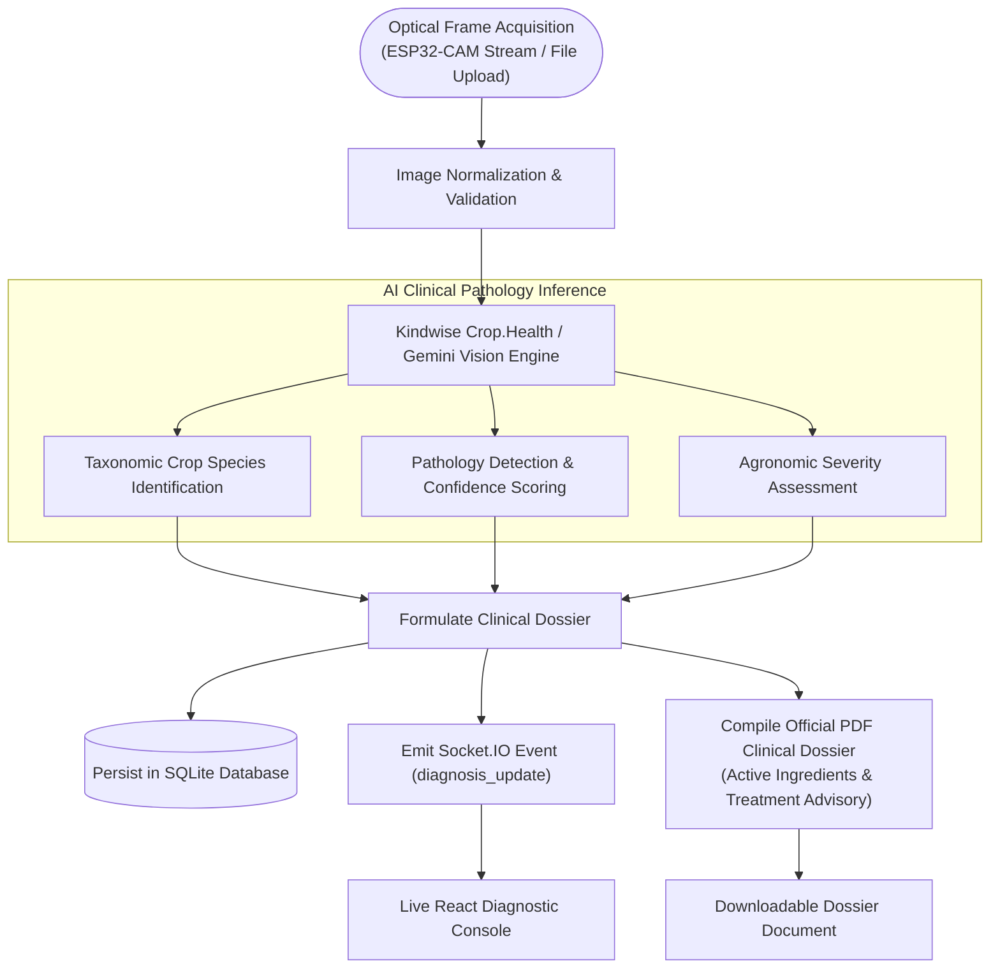
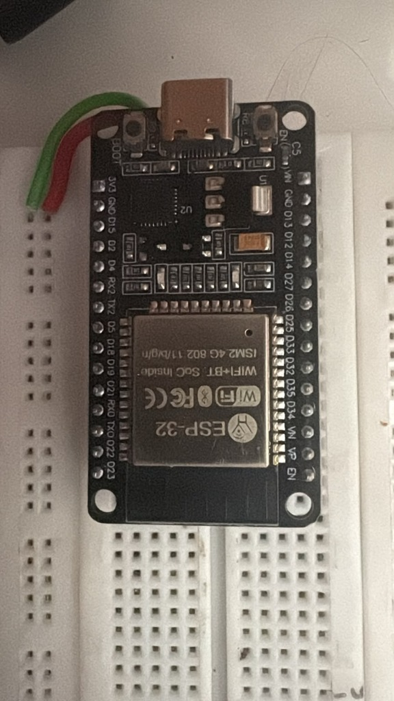

# 🌱 SYNTERRA
### Autonomous Botanical Intelligence & AgriTech IoT Platform

**Engineering Precision Intelligence for Autonomous Agriculture.**

SYNTERRA is an enterprise-grade IoT and AI-driven precision agriculture platform. It bridges edge microcontroller sensing, closed-loop irrigation actuation, real-time agronomic telemetry fusion, and computer vision leaf pathology into an integrated laboratory console.

<p align="center">
  
</p>

---

## 🏛️ System Architecture

SYNTERRA orchestrates four decoupled tiers: Edge Sensing & Actuation, Dual-Link Telemetry Ingestion, Ingestion & Multi-Board Telemetry Fusion, and the Real-Time React Operations Console.



---

## ⚡ Edge Microcontroller Signal & Firmware Flow

The firmware on the USB-C ESP32 Dev Module is architected as an object-oriented `SensorManager` that handles non-blocking multi-sensor sampling, brownout rejection, 5-sample analog noise filtering, dynamic climate classification, and dual dispatch:



---

## 💧 Closed-Loop Autonomous Irrigation Flowchart

SYNTERRA implements an automated closed-loop irrigation policy with safety watchdogs, dry-run reservoir interlocks, and emergency cutoff mechanisms:


---

## 🔬 AI Computer Vision Leaf Pathology Pipeline

When a leaf frame is acquired from the optical studio or live camera stream, SYNTERRA runs multi-stage clinical diagnostic analysis:



---

## 🔌 Hardware Setup & Pin Mapping

<p align="center">
  
</p>

The system operates on a single **USB-C ESP32 Dev Module (Standard 30/38-Pin DevKit)** with zero pin collisions:

| Sensor / Actuator | Module Pin | ESP32 Pin on Board | Bus / Logic Type | Hardware Function & Safety Rules |
| :--- | :--- | :--- | :--- | :--- |
| **DHT11** (Canopy Climate) | `DATA / OUT` | **`D32`** | Bidirectional GPIO | Pulls line LOW for 18ms; requires bidirectional drive (cannot use input-only GPI pins like D34/D35). |
| | `VCC` | **`3V3`** | 3.3V Power Bus | Dedicated 3.3V low-noise rail. |
| | `GND` | **`GND`** | Ground Bus | Common system ground. |
| **FC-28** (Soil Moisture) | `A0` (Analog) | **`D34`** | `ADC1_CH6` | Dedicated ADC1 channel; operational simultaneously with active Wi-Fi radio. |
| | `D0` (Digital) | **`D35`** | Digital Input | Optional onboard comparator threshold alert. |
| | `VCC` | **`3V3`** | 3.3V Power Bus | Low noise sensor power rail. |
| | `GND` | **`GND`** | Ground Bus | Common system ground. |
| **BH1750** (Canopy Lux) | `SDA` | **`D21`** | Hardware I2C SDA | Default ESP32 hardware I2C data line. |
| | `SCL` | **`D22`** | Hardware I2C SCL | Default ESP32 hardware I2C clock line. |
| | `VCC` | **`VIN` (5V)** | 5V Power Rail | Feeds the sensor's onboard 662K LDO regulator cleanly without voltage sag. |
| | `GND` | **`GND`** | Ground Bus | Common system ground. |
| | `ADDR` | *Unconnected* | I2C Address `0x23` | Default I2C address. |
| **Relay Module** (Pump) | `IN / Signal` | **`D27`** | Digital Output | Drives transistor switch for pump coil; normally LOW (safe OFF). |
| | `VCC` | **`VIN` (5V)** | 5V Power Rail | Dedicated coil power rail. |
| | `GND` | **`GND`** | Ground Bus | Common system ground. |

---

## 🌤️ Environmental Climate & Condition Classification Engine

The firmware and backend continuously evaluate ambient photometric, thermal, psychrometric, and substrate metrics to classify macro-atmospheric and microclimate states in real time:

### 1. Photometric Flux Classifications (BH1750 Lux)
* **`< 25 Lux`** &rarr; `🌙 Night / Dark` *(Transpiration paused; dark respiration active)*
* **`25 – 200 Lux`** &rarr; `🌆 Dim / Twilight` *(Low indoor light or twilight transition)*
* **`200 – 1,000 Lux`** &rarr; `☁️ Cloudy / Overcast` *(Soft diffused sunlight under cloud cover)*
* **`1,000 – 10,000 Lux`** &rarr; `⛅ Daylight / Partly Cloudy` *(Optimal daylight photosynthetic radiation)*
* **`10,000 – 25,000 Lux`** &rarr; `☀️ Sunny / Clear Sky` *(Peak clear sky solar radiation)*
* **`> 25,000 Lux`** &rarr; `🔥 Intense Direct Sunlight` *(Elevated radiation; rapid evapotranspiration)*

### 2. Substrate Moisture Classifications (FC-28 Soil Moisture)
* **`< 20 %`** &rarr; `🏜️ Critical Drought` *(Immediate autonomous irrigation triggered)*
* **`20 – 40 %`** &rarr; `⚠️ Dry (Needs Water)` *(Substrate depleted; watering cycle required)*
* **`40 – 75 %`** &rarr; `🌱 Optimal Root Moisture` *(Ideal rhizosphere oxygen & moisture balance)*
* **`> 75 %`** &rarr; `💧 Wet / Saturated` *(Roots fully hydrated)*

### 3. Thermal & Psychrometric Classifications (DHT11)
* **Temperature:** `< 16°C` Cold | `16–22°C` Mild/Cool | `22–28°C` Optimal | `28–34°C` Warm | `> 34°C` Heatwave
* **Relative Humidity:** `< 35%` Arid | `35–65%` Ideal Humidity | `65–80%` Humid/Tropical | `> 80%` Saturated Air
* **Vapor Pressure Deficit (VPD):** Calculated via psychrometric saturation curves:
  $$\text{VP}_{\text{sat}} = 0.61078 \times e^{\left(\frac{17.27 \times T}{T + 237.3}\right)}, \quad \text{VPD} = \text{VP}_{\text{sat}} \times \left(1 - \frac{\text{RH}}{100}\right)$$

---

## 🍅 Multi-Crop Botanical Profiles (Smart Species Adaptation)

SYNTERRA automatically reconfigures autonomous watering thresholds, target VPD limits, and photoperiod goals based on the active crop:

| Species Preset | Scientific Name | Category | Temp Target | Moisture Target | Auto-Watering Trigger | Target DLI | Optimal VPD |
| :--- | :--- | :--- | :--- | :--- | :--- | :--- | :--- |
| **🍅 Tomato** | *Solanum lycopersicum* | Fruiting Solanaceae | $20–26^\circ\text{C}$ | $50–70\%$ | **$45\%$** | $16.0\text{ mol/m}^2/\text{d}$ | $0.8–1.2\text{ kPa}$ |
| **🌿 Sweet Basil** | *Ocimum basilicum* | Culinary Herb | $20–25^\circ\text{C}$ | $60–80\%$ | **$55\%$** | $12.0\text{ mol/m}^2/\text{d}$ | $0.7–1.1\text{ kPa}$ |
| **🍓 Strawberry** | *Fragaria × ananassa* | Berry Crop | $18–24^\circ\text{C}$ | $55–70\%$ | **$50\%$** | $14.0\text{ mol/m}^2/\text{d}$ | $0.6–1.0\text{ kPa}$ |
| **🥬 Lettuce** | *Lactuca sativa* | Leafy Green | $15–21^\circ\text{C}$ | $65–85\%$ | **$60\%$** | $10.0\text{ mol/m}^2/\text{d}$ | $0.5–0.9\text{ kPa}$ |
| **🌵 Succulent** | *Aloe barbadensis* | Xerophytic Succulent | $21–32^\circ\text{C}$ | $15–35\%$ | **$18\%$** | $18.0\text{ mol/m}^2/\text{d}$ | $1.2–1.6\text{ kPa}$ |
| **🪴 Monstera** | *Monstera deliciosa* | Tropical Aroid | $20–28^\circ\text{C}$ | $40–60\%$ | **$35\%$** | $8.0\text{ mol/m}^2/\text{d}$ | $0.6–1.0\text{ kPa}$ |

---

## ☀️ Daily Light Integral (DLI) & Photoperiod Accumulator Engine

Rather than evaluating instantaneous Lux in isolation, SYNTERRA tracks **Daily Light Integral (DLI)**—the cumulative photosynthetic photon flux delivered over a 24-hour cycle:

$$\text{PPFD} \approx \frac{\text{Lux}}{54} \quad (\mu\text{mol} \cdot \text{m}^{-2} \cdot \text{s}^{-1})$$

$$\text{DLI} = \sum_{i} \left( \text{PPFD}_i \times \Delta t_i \right) \times 10^{-6} \quad (\text{mol} \cdot \text{m}^{-2} \cdot \text{d}^{-1})$$

* **Photoperiod Tracker:** Continuously integrates active daylight duration ($\text{Lux} \ge 200$) vs. species target photoperiod.
* **Photometric Gauge:** Displays real-time progress toward the crop's daily photon quota ($16\text{ mol/m}^2/\text{d}$ for Tomato).

---

## ⏱️ 6-Second Dual-Link Telemetry Pipeline

The node operates on a **6-second cadence (`6000 ms`)** with dual-link transmission:
1. **Link A (USB Cable Mode):** Emits structured JSON strings over Serial at `115200` baud. Consumed by `scripts/serial_bridge.py` and forwarded via HTTP POST.
2. **Link B (Wireless Hotspot Mode):** ESP32 connects directly to Wi-Fi hotspot (`jj`) and issues an HTTP POST to `http://<gateway_ip>:5000/api/sensors/telemetry` with header `X-Device-Token: plant-lab-auth-token-9981`.
3. **Multi-Board Fusion:** If multiple nodes report (e.g. ESP32-CAM optical node + USB-C sensor node), the backend automatically fuses readings so missing metrics preserve their latest verified state.

```json
{
  "device_id": "esp32-sensor-01",
  "plant_id": "test-specimen-1",
  "temperature_c": 24.8,
  "humidity_pct": 61.2,
  "soil_moisture_pct": 58.4,
  "soil_raw_adc": 2150,
  "light_lux": 1450.0,
  "light_condition": "Daylight / Partly Cloudy",
  "soil_condition": "Optimal Root Moisture",
  "temp_condition": "Optimal Plant Temp",
  "humidity_condition": "Ideal Canopy Humidity",
  "climate": "Partly Cloudy & Pleasant",
  "water_reservoir_ok": true
}
```

---

## 🚀 Quick Start Guide

### 1. Prerequisites & Environment Setup
```powershell
# Clone the repository
git clone https://github.com/sam-black007/SYNTERRA.git
cd SYNTERRA

# Create virtual environment and activate
python -m venv .venv
.\.venv\Scripts\Activate.ps1

# Install backend dependencies
pip install -r requirements.txt

# Configure secrets
copy .env.example .env
# Set PLANT_API_KEY and DEVICE_TOKEN inside .env
```

### 2. Start the SYNTERRA Server
```powershell
# Double-click start.bat or execute:
python run.py
```
Open **`http://localhost:5000/dashboard`** to access the real-time React console.

### 3. Flash the ESP32 Firmware
1. Open `firmware/Sensor_Hardware_Diagnostic/Sensor_Hardware_Diagnostic.ino` in Arduino IDE.
2. Select Board: **ESP32 Dev Module**.
3. Install required libraries via Library Manager:
   - `DHT sensor library` by Adafruit
   - `BH1750` by Christopher Laws
4. Verify Wi-Fi credentials match your hotspot (`jj` / `123456789`).
5. Select your COM Port and click **Upload**.

### 4. Run the Serial Bridge (Optional / USB Mode)
```powershell
python scripts/serial_bridge.py
```

---

## 📡 API Reference

| Endpoint | Method | Description |
| :--- | :--- | :--- |
| `/dashboard` | `GET` | **Real-Time React 18 Operations Console** |
| `/api/sensors/telemetry` | `POST` | Ingest sensor telemetry JSON (`X-Device-Token` header) |
| `/api/sensors/latest` | `GET` | Retrieve latest fused sensor readings with condition badges |
| `/api/sensors/dli` | `GET` | **Calculate cumulative Daily Light Integral (DLI) & photoperiod** |
| `/api/crops/profiles` | `GET` | List botanical species presets with custom targets |
| `/api/crops/active` | `GET/POST`| Get or switch active crop preset (auto-calibrates irrigation) |
| `/api/sensors/history` | `GET` | Historical telemetry records (`?limit=50`) |
| `/api/sensors/export/csv`| `GET` | Export complete sensor history as CSV |
| `/api/diagnose` | `POST` | Upload leaf photo &rarr; Kindwise Crop.Health disease detection |
| `/api/diagnoses` | `GET` | List all historical pathology diagnoses |
| `/api/diagnosis/<id>/pdf`| `GET` | **Download Official PDF Pathology Dossier with Treatment Plan** |
| `/api/irrigation/status` | `GET` | Read solenoid pump state, countdown & safety interlocks |
| `/api/irrigation/manual` | `POST` | Execute timed manual irrigation pulse (5s–30s) |
| `/api/irrigation/emergency_stop` | `POST` | Instant solenoid pump emergency shutoff |
| `/api/camera/stream` | `GET` | Real-time optical MJPEG video stream |
| `/api/camera/capture` | `POST` | Capture frame from camera node & run AI diagnosis |

---

## 🛠️ Technology Stack

* **Embedded Firmware:** ESP32 C++ (Arduino Core), FreeRTOS, Hardware I2C Wire, DHT sensor library, BH1750.
* **Backend Services:** Python 3.12, Flask 3.0, Flask-SocketIO, SQLAlchemy ORM, SQLite.
* **Frontend Application:** React 18, Vite, Tailwind CSS, Recharts, Lucide Icons, Socket.IO Client.
* **AI & Computer Vision:** Kindwise Crop.Health API / Plant.id, ReportLab PDF generation engine.
* **Protocols & Buses:** WebSocket (WSS), REST JSON, USB-UART CDC, Hardware I2C, 12-bit SAR ADC.

---

## 📄 License & Attribution

Designed and engineered for precision autonomous agriculture. All rights reserved.
